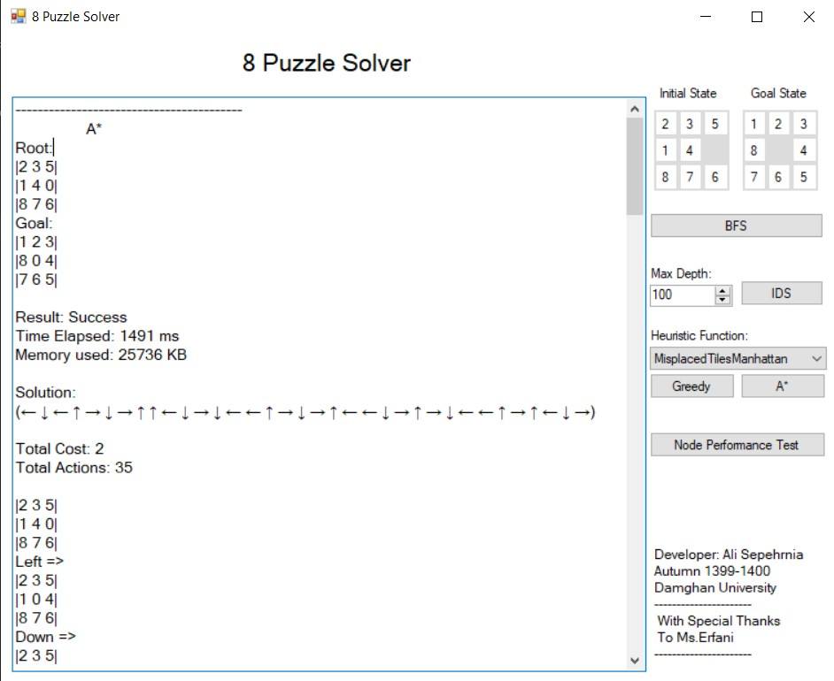

# EightPuzzleAI

> An Artificial Intelligence implementation for solving the classic **8-Puzzle** problem using state-space search algorithms.

[](LICENSE)
[](#)
[](#)



## Overview

EightPuzzleAI is an educational project that demonstrates how classical Artificial Intelligence search algorithms can solve the 8-Puzzle problem.

The project models the puzzle as a state-space search problem and provides reusable implementations of search algorithms, heuristics, and puzzle representations. It is intended for students, researchers, and developers interested in AI search techniques.

---

## Features

- Clean object-oriented architecture
- Multiple search algorithms
- Easy-to-extend solver framework
- Configurable puzzle states
- Solution path reconstruction
- Performance statistics
- Heuristic evaluation
- Educational and well-structured codebase

---

## The 8-Puzzle Problem

The 8-Puzzle consists of a 3×3 board containing:

- Eight numbered tiles
- One empty space

The objective is to move the tiles until they reach the goal configuration.

Example:

Initial State

```
2 8 3
1 6 4
7 _ 5
```

Goal State

```
1 2 3
4 5 6
7 8 _
```

---

## Implemented Algorithms

Depending on your implementation, the project may include:

### Uninformed Search

- Breadth-First Search (BFS)
- Depth-First Search (DFS)
- Depth-Limited Search (DLS)
- Iterative Deepening Search (IDS)

### Informed Search

- Greedy Best-First Search
- A* Search

### Heuristics

- Manhattan Distance
- Misplaced Tiles

---

## Project Structure

```
EightPuzzleAI/
│
├── Models/
├── Algorithms/
├── Heuristics/
├── Solver/
├── Utilities/
├── Program.cs
└── README.md
```

*(Adjust this section to match your actual project structure.)*

---

## Getting Started

### Requirements

- .NET SDK
- Visual Studio 2022 or later

### Clone

```bash
git clone https://github.com/alisepehrnia/EightPuzzleAI.git
```

### Build

```bash
dotnet build
```

### Run

```bash
dotnet run
```

---

## Example Output

```
Initial State

2 8 3
1 6 4
7 _ 5

Algorithm:
A* Search

Heuristic:
Manhattan Distance

Solution Found!

Depth: 10
Expanded Nodes: 254
Generated Nodes: 402
Execution Time: 5 ms
```

---

## Design Goals

- Separation of concerns
- Reusable search framework
- Extensible heuristic system
- Easy integration of new algorithms
- Educational readability

---

## Future Improvements

- 15-Puzzle support
- Graphical User Interface
- Puzzle generator
- Solvability detection
- Additional heuristics
- Bidirectional Search
- IDA*
- Parallel search algorithms
- Benchmark suite

---

## Educational Topics

This project demonstrates concepts including:

- Artificial Intelligence
- State Space Search
- Graph Search
- Tree Search
- Heuristic Search
- A* Algorithm
- Greedy Search
- Breadth-First Search
- Depth-First Search
- Cost Functions
- Heuristic Functions
- Path Reconstruction

---

## Contributing

Contributions are welcome!

Feel free to:

- Report bugs
- Suggest improvements
- Submit pull requests
- Add new algorithms or heuristics

---

## License

This project is licensed under the MIT License.

---

## Author

**Ali Sepehrnia**

GitHub: https://github.com/alisepehrnia
